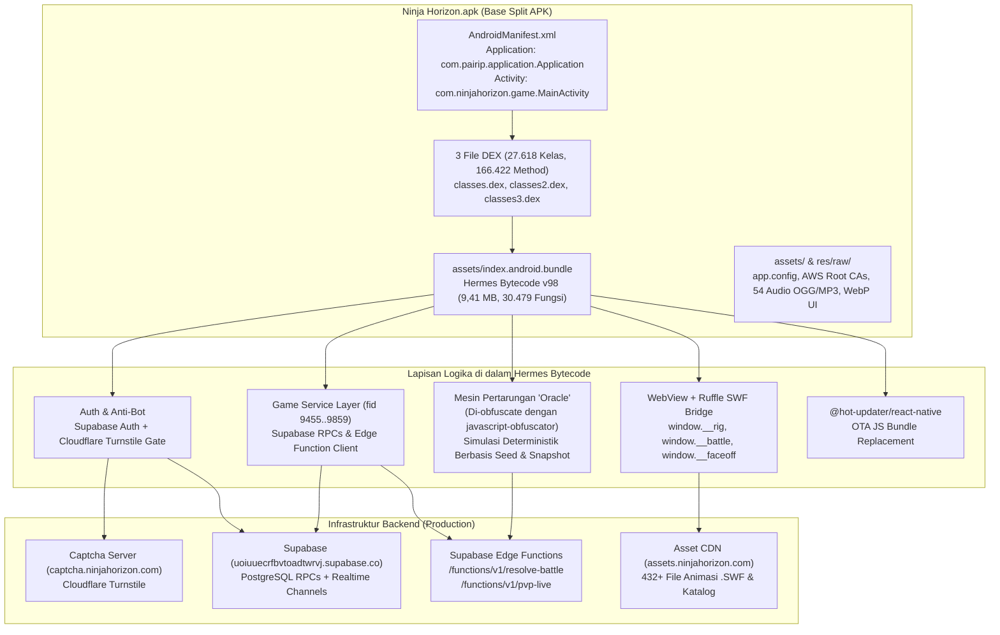

# Laporan Investigasi Reverse Engineering (REA) — Ninja Horizon (`v1.0.2`)

> **Tanggal Investigasi**: 4 November 2026  
> **Target Artefak**: [`Ninja Horizon.apk`](../Ninja%20Horizon.apk)  
> **Metode**: Analisis Statis Berbasis Bukti (*Reverse Engineer Anything* / REA MCP + Dekomposisi AXML, DEX, dan Hermes Bytecode v98)

---

## Daftar Dokumen di Folder `Docs/`

1. **[`01_Laporan_Investigasi_REA.md`](./01_Laporan_Investigasi_REA.md)** *(Dokumen Ini)* — Ringkasan eksekutif, identitas artefak, *tech stack*, arsitektur komponen, cara kerja fitur utama, proteksi keamanan, dan keterbatasan hasil investigasi.
2. **[`02_Katalog_API_RPC_dan_Skema_Data.md`](./02_Katalog_API_RPC_dan_Skema_Data.md)** — Referensi teknis lengkap endpoint Supabase, Edge Functions (`resolve-battle`, `pvp-live`), daftar RPC PostgreSQL, skema tabel `player_avatar`, dan *Hermes Shape Table* (`shape 5680..5955`).
3. **[`03_Mesin_Pertarungan_Oracle_dan_Ruffle_SWF.md`](./03_Mesin_Pertarungan_Oracle_dan_Ruffle_SWF.md)** — Bedah teknis mesin simulasi pertarungan deterministik **Oracle** (hasil dekode 3.559 string *javascript-obfuscator*) dan arsitektur *WebView + Ruffle Flash (.swf) Renderer*.
4. **Folder [`lampiran/`](./lampiran/)** — Bukti mentah hasil ekstraksi & dekode:
   - [`lampiran/AndroidManifest.decoded.xml`](./lampiran/AndroidManifest.decoded.xml)
   - [`lampiran/stage_controller.js`](./lampiran/stage_controller.js)
   - [`lampiran/decoded_jsobf_strings.json`](./lampiran/decoded_jsobf_strings.json)
   - [`lampiran/hermes_strings.json`](./lampiran/hermes_strings.json)

---

## 1. Identitas Artefak & Jejak Bukti REA (*Provenance*)

| Parameter | Nilai Terobservasi |
| :--- | :--- |
| **Nama File** | `Ninja Horizon.apk` |
| **Ukuran File** | `34.721.592` byte (~33,11 MB) |
| **SHA-256 Digest** | `934ebfaf2aacad392e86c05fdf2de2b6bb85331037fc2bb1155de40d19bda71a` |
| **Package Name** | `com.ninjahorizon.game` |
| **Nama Aplikasi & Slug** | `Ninja Horizon` (`slug: "nh-app"`, `scheme: "ninjahorizon"`, `owner: "rubin530"`) |
| **Versi Rilis** | `versionName="1.0.2"`, `versionCode="39"`, `releaseStage="production"` |
| **Target SDK Android** | `minSdkVersion="24"` (Android 7.0), `targetSdkVersion="36"`, `compileSdkVersion="36"` (Android 16) |
| **Tipe Distribusi APK** | **Google Play Base Split APK** (`com.android.vending.derived.apk.id = 3`, `STAMP_TYPE_DISTRIBUTION_APK`) |
| **Kebutuhan Split APK** | `requiredSplitTypes="base__abi,base__density"` (`com.android.vending.splits.required="true"`) |

### Rekaman Bukti REA (*Evidence IDs*)
* **`ev_574994ab5fa6a3d43b6194f6ff06d713abfcd8339bbf4077c396fcc731885cc8`** — `inspect_artifact` pada `Ninja Horizon.apk`.
* **`ev_b7b435cf0df60d5f305168569ce7c8b3f1d32b3eb1284fdf9bcd75afaa7e777f`** — `inventory_artifact` (menginventarisasi **797** *unique content nodes*, **879** *file occurrences*, **878** *edges*, dan **0** kontradiksi integritas).
* **`ev_8d5b81b8468dff7771490000d9dd2c27357d8f36ce4ae31b5ddcf16c707d24dc`** — `inspect_analysis_view` (*summary view*).
* **`ev_d96df695f191be315ff2511e3ad3d6733f7f6773e0cc2f0faa640ed17b2630f6`** — `inspect_analysis_view` (*occurrences view* `0..200`).
* **`ev_f0b9e6badfcbbedff14c381af6c3b1ab979bd2aa032d282b1217613a2576d212`** — `extract_artifact` (mengekstrak seluruh 878 file reguler di dalam APK).
* **`ev_b39f69852853c3dd0161454d56fc51c3bc0d33ffc539e164b930a695db844b04`** — `record_unknown` untuk `unk_95238587a891d873397d364ad650e41fc897a619a831ddba229497b0bdf7e401` (ketiadaan *split APK* ABI `base__abi`).
* **`ev_d185871cb05b81d286a9382e9a538e19922347cb4ff3ef10926fcebf690969e7`** — `record_unknown` untuk `unk_aa5cb8feceb9bed2e6547b1758d718f544c5998eb60d0bc957b79fd4a8b6da90` (validasi otoritatif di sisi server Supabase).

---

## 2. Identifikasi Jenis Aplikasi & Teknologi (*Tech Stack*)

### 2.1 Kategori & Sifat Aplikasi
**Ninja Horizon** adalah permainan *Turn-Based RPG* bertema Ninja yang merupakan adaptasi/penerus modern dari game Flash klasik **Ninja Saga** (*忍者傳說*). Permainan ini menggabungkan antarmuka *mobile* berbasis **React Native (Expo)** dengan mesin emulasi **Adobe Flash (`.swf`) berbasis Ruffle WebAssembly/WebGL** di dalam `WebView` untuk merender karakter, kostum, senjata, hewan peliharaan (*pet*), serta animasi jurus (*jutsu*) pada kecepatan 36 FPS.

### 2.2 Komponen Teknologi Utama

| Lapisan | Teknologi / Pustaka | Bukti di Dalam Artefak |
| :--- | :--- | :--- |
| **Mobile Framework** | **React Native + Expo SDK `55.0.0`** (`newArchEnabled: true`) | `assets/app.config`, `META-INF/ReactAndroid_release.kotlin_module` |
| **JS Engine** | **Hermes Bytecode v98** (`magic: 0x1f1903c103bc1fc6`) | `assets/index.android.bundle` (`9.414.760` byte, SHA-1 source: `a792704a14bf1a0b1765e66803c492e6e2ca03ed`) |
| **Build System** | **AGP `8.12.0`**, **Gradle `9.3.1`**, **Kotlin `2.1.20`** (JVM 17), **R8** | `META-INF/com/android/build/gradle/app-metadata.properties`, `kotlin-tooling-metadata.json` |
| **Animasi & Render SWF** | **Ruffle Flash Player** (`/ruffle/ruffle.js`) di dalam `react-native-webview` | String `[283]`, `[497]`, `[21849]`, `[21850]`, `[21851]` pada `index.android.bundle` |
| **Backend & Database** | **Supabase** (`@supabase/supabase-js`, Auth, PostgREST, Edge Functions, Realtime) | URL: `https://uoiuuecrfbvtoadtwrvj.supabase.co`, Key: `sb_publishable_fmv5Sz29F8kwXJCsa0Q_uQ_F98vjN6J` |
| **Proteksi Anti-Bot** | **Cloudflare Turnstile** (`AnonymousCaptchaGate`) | URL: `https://captcha.ninjahorizon.com/turnstile?mobile=1`, Site Key: `0x4AAAAAAEmcj0VwmQw2VIvS` |
| **OTA Code Push** | **`@hot-updater/react-native`** + Zstandard (`zstd-kmp`) + `bsdiff` | `com.hotupdater.CHANNEL="production"`, URL: `https://updates.ninjahorizon.com/api/check-update` |
| **CDN Aset Game** | **Cloudflare / AWS CloudFront** | `https://assets.ninjahorizon.com` & `https://da08ctfrofx1b.cloudfront.net/` |
| **Pembayaran (IAP)** | **RevenueCat** + **Google Play Billing `8.3.0`** + **Stripe / Paddle** | `billing.properties`, Keys: `goog_CmpcSKSyhhaMjtDXOURvuHwFgUj`, `appl_CzckDzXnCfcSquAteHvxTnuKvVm` |
| **Iklan & Atribusi** | **Google Mobile Ads (AdMob)** + **Tenjin SDK** | AdMob ID: `ca-app-pub-3782520154569268~5175520183`, Tenjin: `ROD2QNVLKFDIBM4P27M7D5GZGQ` |
| **Proteksi Lisensi APK** | **Google Play Automatic Integrity Protection (`com.pairip`)** | `com.pairip.application.Application`, `com.pairip.licensecheck.LicenseClient` di `classes.dex` |

---

## 3. Struktur Aplikasi & Komponen Utama

### 3.1 Diagram Arsitektur Komponen



### 3.2 Dekomposisi File DEX (`classes.dex`, `classes2.dex`, `classes3.dex`)
Total terdapat **27.618 kelas** dan **166.422 method** di seluruh 3 file DEX (`dex\n037\x00`):

1. **`classes.dex` (`7.823.388` byte, SHA-256: `00112e7699a3198ca3cf2c3610018a06eb3fbca9a4e05121d46bb46375177a96`)**:
   * Berisi `9.927` kelas dan `65.402` method.
   * Memuat `com.pairip.application.Application` (yang mewarisi `com.ninjahorizon.game.MainApplication`) serta seluruh paket `com.pairip.licensecheck.*` (`LicenseClient`, `LicenseActivity`, `ILicenseV2ResultListener`).
2. **`classes2.dex` (`9.084.748` byte, SHA-256: `840e1d40b8103a8f5ba7fc8bfdfba78cd3ef1247ed58420c476701cfee8c6047`)**:
   * Berisi `11.770` kelas dan `65.514` method.
   * Memuat **satu-satunya kode paket `com.ninjahorizon.game`** yang hanya terdiri dari **3 kelas wrapper React Native**:
     * `Lcom/ninjahorizon/game/MainApplication;` (`extends android.app.Application`)
     * `Lcom/ninjahorizon/game/MainActivity;` (`extends com.facebook.react.n` / `ReactActivity`)
     * `Lcom/ninjahorizon/game/MainActivity$a;` (`extends com.facebook.react.defaults.b` / `DefaultReactActivityDelegate`)
   * Memuat modul native OTA `com.hotupdater.*` (`HotUpdaterModule`, `HotUpdaterRecoveryManager`, `HotUpdaterRestartActivity`, `HotUpdaterRecoveryReceiver`).
3. **`classes3.dex` (`4.084.104` byte, SHA-256: `023a05355be20042f92e1576c4598c4488e9b85ff8df74bf8ba3bf671729d8d1`)**:
   * Berisi `5.921` kelas dan `35.506` method (pustaka AndroidX, Google Play Services, Billing, RevenueCat, ExoPlayer).

### 3.3 Anatomi Bundel Hermes (`assets/index.android.bundle`)
Bundel utama permainan dikompilasi ke **Hermes Bytecode Version 98** dengan rincian:
* **Ukuran**: `9.414.760` byte (`SHA-256: c8e727e92b9e974469d5227544f79fac83382f03a467529b84e9a98bf76b5689`)
* **Jumlah Fungsi**: `30.479` fungsi (`SmallFuncHeader` berukuran 12 byte mulai offset `128`; `LargeFuncHeader` mulai offset `8.228.488`)
* **Tabel String**: `43.838` entri string (`string_storage_off = 621.580`, ukuran `972.986` byte)
* **Literal & Shape Buffers**:
  * *Literal Value Buffer*: offset `1.594.568` (`164.489` byte)
  * *Object Key Buffer*: offset `1.759.060` (`83.874` byte)
  * *Object Shape Table*: offset `1.842.936` (`6.536` entri *shape* × 8 byte = `52.288` byte)
* **Obfuskasi Selektif**:
  * Kode UI, navigasi, dan *Game Service Layer* (`fid 9455..9859` & generator `fid 23308..23580`) **tidak di-obfuscate** nama fungsinya (hanya di-*minify* oleh Metro/Hermes).
  * Namun, modul mesin pertarungan **Oracle** di-*obfuscate* secara khusus menggunakan **`javascript-obfuscator`** sebelum dikompilasi ke Hermes, menghasilkan **1.774 identifier heksadesimal (`_0x...`)** dan **3.559 string yang dienkode dengan Base64 ber-alfabet terbalik** (`a-zA-Z0-9+/=`). Seluruh 3.559 string ini telah berhasil didekode pada [`lampiran/decoded_jsobf_strings.json`](./lampiran/decoded_jsobf_strings.json).

---

## 4. Cara Kerja Fitur Utama (Berdasarkan Bukti Bytecode)

### 4.1 Autentikasi, Pembuatan Karakter, & Cloudflare Turnstile Gate
1. **Pemeriksaan Sesi (`existingSessionUserId` `fid 9457` / `ensureSession` `fid 9458`)**:
   * Memeriksa sesi aktif melalui `supabase.auth.getSession()` dan memvalidasi token pengguna lewat `supabase.auth.getUser()`.
2. **Gerbang Anti-Bot (`AnonymousCaptchaGate` & `?anon_0_anonymousSignInCaptchaToken` `fid 23571`)**:
   * Pendaftaran akun anonim baru (`supabase.auth.signInAnonymously`) wajib menyertakan `captchaToken` (`shape 5748`).
   * Token diperoleh dari *WebView* yang memuat `https://captcha.ninjahorizon.com/turnstile?mobile=1` dengan kunci `TURNSTILE_SITE_KEY = "0x4AAAAAAEmcj0VwmQw2VIvS"`.
   * Jika token belum siap saat pengguna menekan tombol mulai, fungsi melempar pesan: `"Bot protection is still starting. Please try BEGIN JOURNEY again."`
3. **Pembuatan Karakter (`createAvatar` `fid 9472` -> `fid 23324`)**:
   * Memanggil RPC `create_avatar` (atau `create_avatar_with_referral` jika menyertakan kode referral `p_referral_code`) dengan parameter nama, gender, elemen dasar (`fire`, `water`, `wind`, `lightning`, `earth`), dan tampilan awal (`appearance`).

### 4.2 Sistem Pertarungan Deterministik ("Oracle") & Edge Function `/functions/v1/resolve-battle`
Pertarungan non-live (Mission, Hunting House, Exam Battle, Tower, Clan Battle) menggunakan arsitektur **Hybrid Client-Simulated + Server-Replayed**:
1. **Inisialisasi Sesi Pertarungan**:
   * Klien memanggil RPC sesuai mode (mis. `mission_start`, `hunt_start`, `clan_battle_start`) atau memanggil `startBattle` (`fid 9480` -> `fid 23331`) ke Edge Function `resolve-battle` dengan payload `{"session": session, "mode": "start"}` (`shape 5818`).
2. **Simulasi Lokal di Mesin `Oracle`**:
   * Mesin `Oracle` diinisialisasi menggunakan `seed` + `build snapshot` (`MatchState is detached from its Oracle session; reinitialize from seed + build snapshot`).
   * Seluruh kalkulasi ATB (`BATTLE_ATB_ACTION_TIME`), *damage*, *critical*, *dodge*, *buff/debuff* (`Kekkai`, `Burn`, `Poison`, `Sleep`, `Darkness`, `Ecstasy`, `Dismantle`, `Lock`), *talent*, *senjutsu*, dan aksi *pet/ally* dihitung secara sinkron dan deterministik menggunakan PRNG internal (`rngState`, `nextInt`).
3. **Verifikasi Akhir & Klaim Hadiah (`finishBattle` `fid 9482` -> `resolveBattle` `fid 9475` / `fid 23327`)**:
   * Saat pertarungan berakhir, klien mengirimkan rekaman tindakan (`actions`) ke Edge Function `/functions/v1/resolve-battle`:
     ```json
     {
       "session": "<session_id_or_object>",
       "mode": "finish",
       "response": "<client_battle_result>",
       "actions": ["<daftar_aksi_pemain_selama_pertarungan>"]
     }
     ```
   * Server memutar ulang (*replay*) daftar `actions` tersebut di atas mesin **Oracle** sisi server. Jika valid, server mengembalikan `grant` (XP, Gold, item *drop*) dan memperbarui state pemain (`authoritativeResolvedVerdict`).

### 4.3 Pertarungan Real-Time (`Live PvP` & `Co-op Boss Raid`) via `/functions/v1/pvp-live`
1. **Matchmaking & Lobby**:
   * Klien memanggil RPC `pvp_enqueue` (`{"p_mode": "pvp", "p_engine": ENGINE_VERSION}`) atau `coop_enqueue` / `coop_room_create`.
   * Klien berlangganan (*subscribe*) ke kanal Supabase Realtime (`liveMatchChannel` / `roomChannel`) dan tabel `live_moves`.
2. **Eksekusi Giliran Real-Time**:
   * Setiap aksi dikirim ke Edge Function `/functions/v1/pvp-live`:
     * Inisialisasi *build*: `{"match": matchId, "action": "build"}` (`pvpLiveBuild` `fid 23415`)
     * Pengiriman langkah: `{"match": matchId, "action": "move", "move": movePayload, "seq": sequenceNumber}` (`pvpLiveMove` `fid 23416`)
     * Klaim lawan terputus (*disconnect*): `{"match": matchId, "action": "claim_dc"}` (`pvpLiveClaimDc` `fid 23423`)
     * Penyelesaian akhir: `{"match": matchId, "action": "settle"}` (`pvpLiveSettle` `fid 23420` / `coopLiveSettle` `fid 23433`)
   * Selama pertandingan berlangsung, klien mengirim detak koneksi melalui RPC `pvp_live_heartbeat` (`{"p_match": matchId}`).

### 4.4 Sistem Hub Desa (Village), Clan, Exam, Gacha, & Progression
Seluruh fitur progres dan ekonomi dikendalikan melalui pemanggilan RPC PostgreSQL (`supabase.rpc(...)`) yang divalidasi di sisi server:
* **Academy & Jutsu**: `learn_skill`, `upgrade_skill`, `set_mode_skill_loadout`, `choose_special_class_jutsu`.
* **Talent & Senjutsu (Sage Path)**: `buy_talent`, `reset_talent`, `learn_talent_skill`, `upgrade_talent_skill`, `max_talent_skill`, `senjutsu_choose_school`, `senjutsu_upgrade`, `senjutsu_set_loadout`, `senjutsu_reset`.
* **Chunin/Jounin Exam**: `exam_player_state`, `exam_quiz_get`, `exam_quiz_submit`, `exam_minigame_start`, `exam_minigame_clear`.
* **Forge (Tempa Senjata/Gear/Pet)**: `forge_player_surface_state`, `forge_craft`.
* **Gacha, Dragon Altar, Scratch, & Lucky Wheel**: `gacha_spin`, `gacha_beginner_spin`, `dragon_redeem`, `dragon_ball_swap`, `scratch_play`, `daily_lucky_draw_state`, `daily_lucky_draw_spin`.
* **Clan & Clan Wars**: `clan_me`, `clan_list`, `clan_create`, `clan_request_join`, `clan_respond_request`, `clan_donate`, `clan_upgrade_building`, `clan_battle_start`, `clan_leaderboard`, `clan_season_reward_catalog`.

*(Daftar lengkap seluruh fungsi API, nama RPC, dan parameter input/output dapat dilihat pada dokumen **[`02_Katalog_API_RPC_dan_Skema_Data.md`](./02_Katalog_API_RPC_dan_Skema_Data.md)**).*

---

## 5. Proteksi Keamanan & Hardening yang Diterapkan

1. **Google Play Integrity / PairIP (`com.pairip.licensecheck.*`)**:
   * Kelas `Application` utama di `AndroidManifest.xml` diganti menjadi `com.pairip.application.Application`.
   * Saat aplikasi dijalankan, `LicenseClient` melakukan *binding* ke layanan Google Play Store (`com.android.vending.licensing.ILicensingService`) dan memverifikasi lisensi distribusi (`TRANSACTION_CHECK_LICENSE_V2`). Jika aplikasi dijalankan di lingkungan tanpa lisensi Google Play yang valid atau tanda tangan APK dimodifikasi, `LicenseActivity` akan menghentikan aplikasi.
2. **Custom Expo Release Hardening Plugins**:
   * Di `assets/app.config`, pengembang mengaktifkan `./plugins/withAndroidReleaseControls` dan `./plugins/withReleaseHardening` (`enableMinifyInReleaseBuilds: true`, `enableShrinkResourcesInReleaseBuilds: true`, `allowBackup: false` pada konfigurasi plugin).
   * Di dalam kode JS terdapat penjaga lingkungan: `"Release builds require the production NinjaHorizon backend."` dan `"EXPO_PUBLIC_NINJA_ENV=local cannot target the production Supabase project."`
3. **Verifikasi Kriptografis OTA Bundle (`@hot-updater`)**:
   * Setiap pembaruan bundel JS yang diunduh dari `https://updates.ninjahorizon.com/api/check-update` diverifikasi terhadap kunci publik **RSA-4096** yang tertanam di `AndroidManifest.xml` (`com.hotupdater.PUBLIC_KEY`) serta *fingerprint* `c57ca294975fd60aa95a41af2dd0cad363e49f9f`.

---

## 6. Keterbatasan Hasil Investigasi (*Limitations & Residual Unknowns*)

1. **Ketiadaan Split APK Arsitektur Native (`base__abi`) — [`unk_95238587a891d873397d364ad650e41fc897a619a831ddba229497b0bdf7e401`]**
   * `Ninja Horizon.apk` adalah *Base Split APK* yang tidak menyertakan folder `lib/<abi>/*.so`. Pustaka native C/C++ (seperti `libhermes.so`, `libreactnative.so`, dan `libpairipcore.so`) berada di dalam *split APK* ABI pendamping (`split_config.arm64_v8a.apk`). Analisis instruksi mesin level C/C++ pada `libpairipcore.so` memerlukan file *split* pendamping tersebut.
2. **Logika Validasi Server-Side yang Tidak Berada di Klien — [`unk_aa5cb8feceb9bed2e6547b1758d718f544c5998eb60d0bc957b79fd4a8b6da90`]**
   * Implementasi SQL di balik RPC PostgreSQL serta kode server Edge Functions (`/functions/v1/resolve-battle` dan `/functions/v1/pvp-live`) dieksekusi di cloud Supabase (`uoiuuecrfbvtoadtwrvj.supabase.co`). Analisis statis pada APK klien berhasil mengungkap seluruh kontrak request/response dan logika simulasi klien **Oracle**, namun batas toleransi *anti-cheat* server (seperti pengecekan *timestamp*/kecepatan giliran di sisi server) hanya dapat diamati melalui pengujian trafik runtime.
3. **Potensi Perubahan Bundel melalui OTA (`@hot-updater`)**:
   * Karena aplikasi menggunakan `@hot-updater/react-native`, bundel `assets/index.android.bundle` yang dianalisis di sini adalah versi bawaan APK `1.0.2` (`versionCode 39`). Server produksi dapat mengirimkan *patch* bundel JS baru ke perangkat pengguna tanpa melalui pembaruan APK di Play Store.
