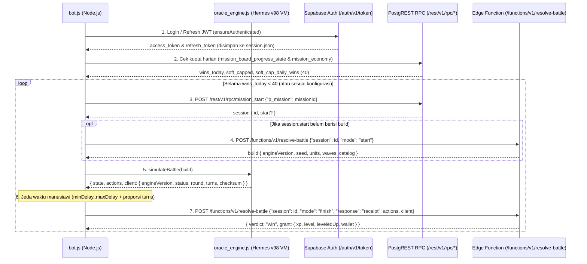

# 04 — Panduan & Arsitektur Bot AFK EXP Headless (Metode A)

Dokumen ini menjelaskan arsitektur teknis, mekanisme kerja, serta panduan penggunaan **Headless AFK EXP Bot (Metode A)** yang telah dibangun di direktori [`bot/`](../bot/).

---

## 1. Gambaran Umum Arsitektur (Metode A)

Pada **Metode A (Pure Background / Headless API Bot)**, bot berjalan sepenuhnya di Node.js tanpa memerlukan emulator Android, layar, maupun antarmuka grafis (0% penggunaan GPU).

Tantangan terbesar pada Metode A adalah validasi deterministik dari server *Ninja Horizon*:
1. Saat pertarungan dimulai (`POST /functions/v1/resolve-battle` dengan `mode: "start"`), server memberikan `build` yang berisi `engineVersion`, `seed` (PRNG `imul32`), daftar `units`, `waves`, dan `catalog` (definisi *skill*, *gear*, dan musuh).
2. Saat pertarungan selesai (`mode: "finish"`), klien wajib mengirimkan:
   - Array `actions`: urutan aksi setiap giliran (`{ type: "skill", skillId: "..." }`, `{ type: "attack" }`, dll.).
   - Objek `client` (`replayDiagnostic`): berisi `{ engineVersion, status, round, turns, activeId, checksum }`.
3. Server kemudian memutar ulang (*replay*) pertarungan dari `seed` awal menggunakan `actions` yang dikirimkan klien dan mencocokkan nilai `checksum` akhir (`fnv1a` 32-bit bertanda).

### Solusi: Eksekusi Langsung Bytecode Hermes v98 Mesin Oracle (`oracle_engine.js`)
Agar perhitungan PRNG, *turn gauge*, *damage*, *status effects*, hingga *checksum* `fnv1a` dijamin **100% identik** dengan aplikasi resmi (dan tahan terhadap perbedaan pembulatan *floating-point* atau *edge-case*), kami mengekstrak seluruh 3.806 fungsi bytecode Hermes v98 yang membentuk modul **Oracle Battle Engine** langsung dari [`index.android.bundle`](../Docs/03_Mesin_Pertarungan_Oracle_dan_Ruffle_SWF.md) ke dalam:
- [`bot/oracle_bytecode.bin`](../bot/oracle_bytecode.bin) & [`bot/oracle_meta.json`](../bot/oracle_meta.json): Paket instruksi bytecode, tabel string, *object/array literal buffers*, dan *switch tables* untuk modul `627`, `628`, `629`, `630`, dan `631`.
- [`bot/oracle_engine.js`](../bot/oracle_engine.js): Mesin Virtual (*Virtual Machine*) Hermes v98 mandiri di Node.js yang memuat ketiga versi mesin Oracle sekaligus:
  - `8b314b03` (Oracle terbaru — `module 628`)
  - `b87fcb76` (Oracle kompatibilitas — `module 629`)
  - `5022613f` (Oracle legacy — `module 630`)

Dengan pendekatan ini, ketika server meminta simulasi menggunakan versi mesin mana pun (`8b314b03`, `b87fcb76`, atau `5022613f`), [`simulateBattle()`](../bot/oracle_engine.js#L510-L574) secara otomatis memilih modul yang tepat, menjalankan `initMatch` -> `runUntilHuman` -> `suggestPlannedAction` / `suggestPlayerAction` -> `applyAction`, dan menghasilkan `checksum` yang terverifikasi 100% cocok dengan fungsi `engine.replay()`.

---

## 2. Alur Siklus Kerja Bot (`bot/bot.js`)



### Fitur Keamanan & Reliabilitas Bawaan di [`bot/bot.js`](../bot/bot.js)
1. **Header Protokol Identik dengan APK Asli**:
   Mengirimkan header persis seperti `interceptedFetch` (`func[22436]`):
   - `apikey: sb_publishable_fmv5Sz29F8kwXJCsa0Q_uQ_F98vjN6J`
   - `x-client-info: supabase-js-react-native/2.97.0 nh-senjutsu/1`
   - `x-battle-engines: 8b314b03,b87fcb76,5022613f`
   - `x-battle-protocol: 1`
2. **Fallback Region Otomatis (`?forceFunctionRegion=us-east-1`)**:
   Meniru `createBattleRegionFetch` (`func[26886]`) di APK: jika Edge Function mengembalikan HTTP `502`/`504`/`503`, bot otomatis mengalihkan rute ke region `us-east-1` selama 60 detik.
3. **Retry Otomatis pada Timeout Penyelesaian Battle**:
   Meniru `finishBattle` (`func[23327]`): jika server mengalami lonjakan beban dan mengembalikan HTTP `504` atau `546` saat `mode: "finish"`, bot otomatis melakukan *retry* tanpa kehilangan sesi pertarungan.
4. **Auto-Refresh Token Sesi (`session.json`)**:
   Token JWT memiliki masa berlaku 1 jam. Bot membaca klaim `exp` pada JWT dan secara otomatis memperbarui token menggunakan `refresh_token` sebelum habis, sehingga dapat berjalan AFK berjam-jam tanpa putus.
5. **Proteksi Kuota Harian (*Soft-Cap* 40 Kemenangan)**:
   Secara bawaan (`"stopOnSoftCap": true`), bot memeriksa `wins_today` dan berhenti otomatis ketika mencapai 40 kemenangan harian (titik di mana hadiah dikurangi menjadi 25%).

---

## 3. Struktur File di Folder `bot/`

| File | Deskripsi |
| :--- | :--- |
| [`bot/bot.js`](../bot/bot.js) | Skrip utama CLI Bot AFK EXP (`NinjaHorizonClient`, manajemen sesi, loop misi, dan CLI). |
| [`bot/oracle_engine.js`](../bot/oracle_engine.js) | Interpreter bytecode Hermes v98 untuk mengeksekusi modul Oracle (`8b314b03`, `b87fcb76`, `5022613f`). |
| [`bot/oracle_bytecode.bin`](../bot/oracle_bytecode.bin) | Paket biner instruksi bytecode dari 3.806 fungsi mesin Oracle yang diekstrak dari APK. |
| [`bot/oracle_meta.json`](../bot/oracle_meta.json) | Metadata fungsi, tabel string, dan *literal buffers* untuk `oracle_engine.js`. |
| [`bot/config.example.json`](../bot/config.example.json) | Contoh file konfigurasi akun dan parameter bot. |
| [`bot/package.json`](../bot/package.json) | Definisi skrip npm (`npm test`, `npm start`, `npm run status`). Tidak memerlukan `npm install` (0 dependensi eksternal). |

---

## 4. Cara Konfigurasi & Penggunaan

### Langkah 1: Verifikasi Mesin Simulasi Secara Offline
Pastikan Node.js (v18+) sudah terpasang, lalu jalankan pengujian simulasi offline:

```powershell
cd "bot"
node bot.js --test-sim
```

Output yang diharapkan:
```text
[INFO]  Versi mesin Oracle yang dimuat: 8b314b03, b87fcb76, 5022613f (terbaru: 8b314b03)
[OK]    Engine [8b314b03] -> Status: WIN | Round: 5 | Turns: 9 | Actions: 5 | Checksum: 174593708 (Replay Verified)
[OK]    Engine [b87fcb76] -> Status: WIN | Round: 5 | Turns: 9 | Actions: 5 | Checksum: 174593708 (Replay Verified)
[OK]    Engine [5022613f] -> Status: WIN | Round: 5 | Turns: 9 | Actions: 5 | Checksum: 174593708 (Replay Verified)
[OK]    Semua 3 versi mesin Oracle berjalan 100% deterministik dan siap digunakan!
```

### Langkah 2: Autentikasi Akun (SSO Google atau Email/Password)

#### Opsi A (Direkomendasikan): Login Interaktif via SSO Google (`--login-google`)
Dari hasil dekompilasi fungsi `restoreSignIn` (`func[25111]`), `runOAuth` (`func[25108]`), dan `parseAuthUrl` (`func[10494]`) di dalam APK, *Ninja Horizon* menggunakan alur *Implicit OAuth* Supabase (`/auth/v1/authorize?provider=google&prompt=select_account`). Ketika login Google di browser selesai, Supabase mengalihkan (*redirect*) browser ke halaman statis `https://ninjahorizon.com/#access_token=...&refresh_token=...`.

Karena halaman `https://ninjahorizon.com` adalah halaman *landing* statis yang tidak menghapus *fragment* `#access_token=...` dari *Address Bar* browser, Anda **tidak perlu memasukkan email maupun password** ke dalam `config.json`:

1. Jalankan perintah berikut di terminal:
   ```powershell
   node bot.js --login-google
   ```
   *(Atau `npm run login`)*
2. Browser default PC Anda akan otomatis terbuka ke halaman pilih akun Google resmi *Ninja Horizon*.
3. Pilih akun Google Anda. Setelah dialihkan ke `https://ninjahorizon.com/#access_token=...`, **salin (Copy) seluruh URL dari Address Bar browser** Anda.
4. **Tempel (Paste)** URL tersebut ke terminal `bot.js`.
5. [`runGoogleSsoLogin()`](../bot/bot.js#L563-L637) akan mengekstrak `access_token` dan `refresh_token` menggunakan logika [`parseAuthCallbackUrl()`](../bot/bot.js#L525-L551), menyimpannya ke `bot/session.json`, dan otomatis memperbarui token sesi di masa mendatang tanpa perlu login ulang.

#### Opsi B: Konfigurasi Manual via File `bot/config.json`
Salin [`bot/config.example.json`](../bot/config.example.json) menjadi `bot/config.json`:

```powershell
Copy-Item config.example.json config.json
```

Jika Anda sudah login menggunakan `--login-google`, biarkan kolom `email`, `password`, `refreshToken`, dan `accessToken` di `config.json` tetap kosong `""` (bot otomatis membaca `bot/session.json`). Jika menggunakan akun email biasa, Anda dapat mengisi `"email"` dan `"password"`.

Contoh isi `bot/config.json`:
```json
{
  "email": "akun_anda@email.com",
  "password": "password_anda",
  "refreshToken": "",
  "accessToken": "",
  "missionId": "msn_1",
  "autoPlan": true,
  "minDelaySeconds": 8,
  "maxDelaySeconds": 15,
  "betweenMissionMinSeconds": 4,
  "betweenMissionMaxSeconds": 9,
  "stopOnSoftCap": true,
  "maxRuns": 0
}
```

### Langkah 3: Cek Status Akun & Daftar Misi
Sebelum menjalankan loop AFK, Anda dapat memeriksa koneksi autentikasi, jumlah kemenangan hari ini, serta daftar ID misi yang tersedia:

```powershell
# Cek status kuota harian & ekonomi misi
node bot.js --status

# Tampilkan daftar misi & progress papan misi dari server
node bot.js --list-missions
```

### Langkah 4: Jalankan Bot AFK EXP
Untuk menjalankan bot sesuai `config.json`:

```powershell
node bot.js
```

Atau dengan argumen tambahan langsung dari terminal:
```powershell
# Jalankan misi tertentu sebanyak 10 kali
node bot.js --mission msn_2 --runs 10
```

---

## 5. Tips Keamanan Penggunaan (Anti-Deteksi)

1. **Jangan Mengubah `minDelaySeconds` Menjadi `0`**:
   Meskipun `oracle_engine.js` sanggup menyelesaikan simulasi pertarungan hanya dalam ~0,2 detik di CPU, manusia membutuhkan waktu beberapa detik untuk menyelesaikan pertarungan. Pertahankan `minDelaySeconds` minimal di angka `8`–`15` detik.
2. **Jangan Membuka Pertarungan di Aplikasi HP Secara Bersamaan**:
   Saat bot sedang berjalan, server hanya mengizinkan satu sesi misi aktif per karakter (`mission_start`). Membuka pertarungan dari HP secara bersamaan dapat memicu konflik sesi.
3. **Manfaatkan `stopOnSoftCap: true`**:
   Setelah 40 kemenangan per hari, hadiah EXP dan Gold dipangkas oleh server menjadi 25% (`soft_cap_Consolidation_mult: 0.25`). Berhenti otomatis pada batas 40 kemenangan menjaga pola aktivitas akun tetap wajar seperti pemain aktif harian.


---

## 6. Pembaruan: Engine OTA, Ekonomi Misi Sebenarnya & Pemilihan Misi Otomatis

Pengujian dengan akun nyata (login SSO Google) mengungkap tiga koreksi penting terhadap asumsi awal:

### 6.1 Engine bawaan APK sudah "retired" oleh server
`game_config.battle_engine_policy` (revisi 30) di server:

| Field | Nilai |
| :--- | :--- |
| `active` | `a2c6a492` |
| `accepted` | `47931e6b`, `a2c6a492` |
| `retired` | termasuk `8b314b03`, `b87fcb76`, `5022613f` (ketiga engine di APK) |

Aplikasi asli memperbarui dirinya lewat **HotUpdater OTA** (`https://updates.ninjahorizon.com/api/check-update/fingerprint/android/<FINGERPRINT_HASH>/production/<bundleId>/<minBundleId>`, format URL dari `checkUpdate` `func[28193]`). Bundle OTA terbaru (`01a1a32e-d172-747c-8354-4621131e982a`, *"Clan Quick verification window"*) diunduh, lalu modul engine diekstrak ulang:

| Versi Engine | Modul OTA | Keterangan |
| :--- | :--- | :--- |
| `a2c6a492` | `628` | Engine aktif server (default bot) |
| `47931e6b` | `630` | Engine yang masih diterima |

`oracle_bytecode.bin` / `oracle_meta.json` sekarang berisi 2.556 fungsi dari bundle OTA. Versi lama disimpan di `bot/legacy_apk_engines/`. Bot memeriksa `battle_engine_policy` setiap kali start dan **berhenti dengan pesan jelas** jika engine lokal sudah tidak diterima (artinya perlu ekstrak ulang dari OTA terbaru).

### 6.2 `mission_economy` bukan RPC, dan tidak ada `wins_today`
- RPC `mission_economy` tidak ada. Konfigurasi dibaca dari tabel `game_config` (`key = 'mission_economy'`), sesuai `fetchMissionEconomy` (`func[23579]`).
- `mission_board_progress_state` hanya mengembalikan `{ clears: [...] }`.
- Aturan sebenarnya: **daily double** (3 kemenangan pertama per hari x2) dan **gold soft-cap** (setelah 15 kemenangan per hari, gold tinggal 25%). Tidak ditemukan batas XP harian.
- Karena itu bot menghitung kemenangan hariannya sendiri di `bot/daily.json` (hari UTC). Batas default = `mission_gold_soft.full_wins` (15), bisa diubah dengan `maxWinsPerDay`.

### 6.3 Pemilihan misi otomatis
Dengan `"missionId": "auto"` (default baru), bot membaca level dari `player_avatar` dan memilih misi non-exam dengan XP tertinggi dari `mission_defs` yang levelnya ≤ level karakter. Lihat kandidatnya dengan `node bot.js --list-missions`.


---

## 7. Fitur Baru: Farming World Boss & Event Boss

### 7.1 Mekanisme World Boss
World Boss berjalan secara mingguan (`week_id`) dan menggunakan sistem tiket harian:
- **Status & Info**: RPC `world_boss_state` mengembalikan info bos aktif, tiket tersisa (`tickets`), waktu reset, serta daftar milestone hadiah skor mingguan (`milestones`).
- **Memulai Pertarungan**: RPC `world_boss_start` dengan parameter `{"p_week_id": weekId, "p_request_id": uuid()}`. RPC ini menghasilkan `session.id` yang langsung dihubungkan ke Edge Function `/functions/v1/resolve-battle`.
- **Eksekusi Battle**: Bot melakukan simulasi giliran via `oracle_engine.js`, menghitung damage akumulatif terhadap boss, dan mengirimkan receipt ke server dengan jeda waktu realistis.
- **Auto Claim Milestones**: Jika flag `--auto-claim` diaktifkan, bot secara otomatis memanggil RPC `world_boss_claim` untuk setiap milestone skor yang sudah terpenuhi namun belum diklaim (`claimed: false`).

**Contoh Perintah World Boss:**
```powershell
# Cek sisa tiket, HP/level bos, dan milestone mingguan
node bot.js --wb-status

# Habiskan seluruh tiket World Boss hari ini
node bot.js --wb

# Habiskan 2 tiket World Boss dan klaim milestone yang tercapai
node bot.js --wb --runs 2 --auto-claim
```

### 7.2 Mekanisme Event Boss & Hunting House
Event Boss terintegrasi dengan modul Hunting House (`hunt_start`):
- **Status & Katalog Event**: Bot mengambil data bos event via RPC `events_surface_state` dan `hunting_catalog_state`.
- **Pengecekan Stamina**: Memeriksa ketersediaan stamina event via RPC `event_stamina`.
- **Memulai Pertarungan**: RPC `hunt_start` dengan parameter `{"p_room": roomId}`.
- **Eksekusi Battle**: Menggunakan pipeline yang sama (`resolve-battle` -> `oracle_engine` -> `resolve-battle`), memastikan drop material event terkumpul secara otomatis.

**Contoh Perintah Event Boss:**
```powershell
# Lihat daftar event boss aktif dan katalog monster hunting
node bot.js --list-bosses

# Serang event boss yang direkomendasikan otomatis
node bot.js --event

# Serang event boss spesifik sebanyak 3 ronde
node bot.js --event --boss-id evt_boss_1 --runs 3
```


### 7.3 Mekanisme Auto Hunting House (Kari Badges)
Hunting House merupakan dungeon permanen pemburu monster (`venue: "hunting"`):
- **Syarat Level**: Minimal **Level 10** (`feature_gates.hunting: 10`). Server melempar `PTLOCK:hunting:10` jika karakter belum mencapai Lv 10.
- **Mata Uang Entry**: Menggunakan **Kari Badge** (`item_509`). Biaya masuk standar 5 Kari Badges, menang mengembalikan 1 Badge (`game_config.kari_badge_economy`). Pemain mendapatkan 10 Badges gratis setiap hari.
- **Pemilihan Room Otomatis (`--hunting`)**: Bot otomatis memilih monster dengan rank dan hadiah tertinggi yang memenuhi syarat level karakter (`encounter_level <= avatar.level`):
  - Lv 10: *Hunter's Forest* (`hunt_ginkotsu`)
  - Lv 20: *Third Laboratory* (`hunt_yanki`)
  - Lv 25: *Sealing Stone Vault* (`hunt_gedo`)
  - Lv 30: *Tengu Roost* (`hunt_tengu`)
  - Lv 40: *Byakko's Den* (`hunt_byakko`)
  - Lv 50: *Ape Mountain* (`hunt_apeking`)
  - Lv 55: *Northern Shoals* (`hunt_turtle`)
  - Lv 60: *Samu Village Ruins* (`hunt_mutoh`)

**Contoh Perintah Hunting House:**
```powershell
# Cek saldo Kari Badge dan daftar room yang terbuka
node bot.js --hunt-status

# Farming otomatis room tertinggi sesuai level
node bot.js --hunting

# Farming room spesifik sebanyak 5 ronde
node bot.js --hunting --room hunt_ginkotsu --runs 5
```

### 7.4 Mekanisme Auto Eudemon Garden (Taman Makhluk Mistis)
Eudemon Garden merupakan pertarungan tingkat lanjut (`venue: "eudemon"`):
- **Hadiah**: Memberikan EXP sangat tinggi (20.000 s.d 75.000 XP per pertarungan) dan material senjata khusus untuk *Garden Forge*.
- **Syarat Level**: Minimal **Level 10** (`encounter_level` berkisar antara Lv 10 hingga Lv 80).
- **Pemilihan Room Otomatis (`--eudemon`)**: Bot otomatis mencocokkan level karakter ke room terbaik:
  - Lv 10: *Kamaitachi Garden* (`eudemon_kamaitachi` - 20k XP)
  - Lv 20: *Hell Horse Garden* (`eudemon_hell_horse` - 23k XP)
  - Lv 25: *Kabutomushi Musha Garden* (`eudemon_kabutomushi` - 25k XP)
  - Lv 30: *Kinkaku & Ginkaku Garden* (`eudemon_kinkaku_ginkaku` - 30k XP)
  - Lv 40: *Thunder Eagle Garden* (`eudemon_thunder_eagle` - 35k XP)
  - Lv 50: *Mammoth King Garden* (`eudemon_mammoth_king` - 38k XP)
  - Lv 55: *Oceans Queen Garden* (`eudemon_oceans_queen` - 40k XP)
  - Lv 60: *Ghost Soldier Garden* (`eudemon_ghost_soldier` - 48k XP)
  - Lv 70: *Battle Angel Garden* (`eudemon_battle_angel` - 56k XP)
  - Lv 80: *Infernal Chimera Garden* (`eudemon_infernal_chimera` - 75k XP)

**Contoh Perintah Eudemon Garden:**
```powershell
# Farming otomatis room Eudemon Garden terbaik
node bot.js --eudemon

# Farming room spesifik sebanyak 3 ronde
node bot.js --eudemon --room eudemon_kamaitachi --runs 3
```

---

## 8. Mode Shinobi Tower (Tower of Trials)

Shinobi Tower adalah mode panjat menara mingguan tanpa batas (*infinite climb*) di mana setiap 5 lantai dijaga oleh musuh elit dan setiap 10 lantai dijaga oleh bos penjaga menara.

### 8.1 Mekanisme & Protokol RPC Shinobi Tower
Dari hasil reverse engineering bundle Hermes (modul `useTower`, FID `809`, FID `9212`, FID `22907`):
- **`tower_state`**: Mengambil status menara pemain saat ini, termasuk `record_floor`, `best_floor`, `week_id`, `rank`, `sweep`, dan daftar `milestones`.
- **`tower_start`**: Memulai pertarungan menara dengan parameter `{ p_week_id, p_floor }`. Mengembalikan sesi pertarungan yang dieksekusi menggunakan mesin Oracle Edge Function (`/functions/v1/resolve-battle`).
- **`tower_sweep`**: Menyapu lantai instan dengan parameter `{ p_week_id }` hingga target sweep minggu lalu (`sweep.target`).
- **`tower_rankings`**: Mengambil peringkat mingguan pemain global (`p_week_id`, `p_page`, `p_page_size`).
- **Syarat Fitur**: Karakter minimal **Level 10** (`feature_gates.tower: 10`).

### 8.2 Fitur Auto-Climb & Auto-Sweep Bot
Bot menyediakan otomatisasi pendakian bertahap:
1. **Pendeteksian Lantai Otomatis**: Bot mendeteksi posisi `record_floor` akun dan langsung menantang lantai berikutnya (`record_floor + 1`).
2. **Pacing Realistis**: Mengikuti ritme pertempuran asli (700–950 ms per turn) agar terhindar dari deteksi bot atau timeout.
3. **Pemberhentian Cerdas**: Bot otomatis berhenti jika:
   - Mengalami kekalahan pada lantai yang sulit.
   - Telah mencapai target lantai (`--target-floor <lantai>`).
   - Telah menyelesaikan kuota pendakian (`--max-floors <jumlah>`).
4. **Auto-Sweep**: Menjalankan sweep instan sebelum pendakian dimulai jika opsi `--auto-sweep` disertakan.

### 8.3 Contoh Perintah Penggunaan Shinobi Tower
```powershell
# 1. Cek status rekor lantai, rank mingguan, dan lawan lantai berikutnya
node bot.js --tower-status

# 2. Daki menara secara otomatis lantai demi lantai tanpa batas (sampai kalah)
node bot.js --tower

# 3. Daki menara dengan target berhenti di lantai tertentu (mis. lantai 80)
node bot.js --tower --target-floor 80

# 4. Batasi pendakian maksimal 5 lantai dalam satu sesi
node bot.js --tower --max-floors 5

# 5. Jalankan sweep hadiah instan jika tersedia
node bot.js --tower-sweep

# 6. Jalankan sweep terlebih dahulu kemudian lanjutkan auto-climb
node bot.js --tower --auto-sweep
```

---

## 9. Panduan Ujian Promosi Ninja (Auto Exam: Level 20, 40, 60, & 80)

Ujian Promosi (*Rank Promotion Exam*) adalah mekanisme inti Ninja Horizon untuk menaikkan pangkat ninja, membuka batas level (*level cap*), serta membuka fitur-fitur lanjutan game.

### 9.1 Struktur Tingkatan Ujian & Manfaat Promosi
Jika ninja telah mencapai batas level di bawah ini, EXP akan terhenti (*level cap blocked*) sampai pemain lulus seluruh tahapan ujian pada tingkatan tersebut:

| Level | Pangkat Asal | Pangkat Promosi | Batas Cap Baru | Fitur Terbuka | Misi Track Normal | Misi Track Tensai |
|---|---|---|---|---|---|---|
| **Lv 20** | Genin | **Chunin** | Lv 40 | Pet Centre (Peliharaan Ninja) | `msn55` s/d `msn59` (5 stage) | `msn815` s/d `msn819` (5 stage) |
| **Lv 40** | Chunin | **Jounin** | Lv 60 | Sistem Talents Ninja | `msn132` s/d `msn136` (5 stage) | `msn823`, `msn820`, `msn824`, dll (5 stage) |
| **Lv 60** | Jounin | **Special Jounin** | Lv 80 | Special Class Jutsu | `msn227` s/d `msn238` (8 stage) | `msn205` s/d `msn212` (8 stage) |
| **Lv 80** | Special Jounin | **Ninja Tutor** | Lv 100 | Senjutsu (Sage Arts) | `msn252` s/d `msn258` (7 stage) | `msn259` s/d `msn265` (7 stage) |

### 9.2 Protokol RPC & Variasi Stage Ujian
Berdasarkan reverse engineering bundle Hermes (modul `useRankExam`, FID `788`, `22631–22637`, `26438`, `27620`):
1. **`exam_player_state`**: Memeriksa daftar stage yang telah diselesaikan (`clears`), level cap, dan track aktif via `{ p_rank: rank }`.
2. **Tahap Kuis (`trial_kind: "quiz"`)**:
   - `exam_quiz_get` (`{ p_mission }`): Mengambil daftar soal kuis ninja tertulis.
   - `exam_quiz_submit` (`{ p_mission, p_answers }`): Mengirim lembar jawaban untuk verifikasi server.
3. **Tahap Minigame Segel / Kekkai (`trial_kind: "handseals" | "kekkai"`)**:
   - `exam_minigame_start` (`{ p_mission }`): Memulai sesi minigame.
   - `exam_minigame_clear` (`{ p_mission }`): Menyelesaikan tantangan segel tangan atau formasi kekkai.
4. **Tahap Pertarungan Ujian (Solo & Team Battle)**:
   - Dijalankan via `mission_start` dan diselesaikan secara deterministik oleh mesin Oracle Edge Function (`/functions/v1/resolve-battle`).

### 9.3 Otomatisasi Terintegrasi pada Bot AFK EXP
Bot headless telah mengintegrasikan fitur ujian promosi ini secara penuh ke dalam loop `runAfkBot`:
- **Pengecekan Awal**: Saat bot dijalankan, jika level avatar adalah 20, 40, 60, atau 80, bot langsung memeriksa kelulusan ujian sebelum mulai farming.
- **Pemicu Naik Level (Auto Trigger)**: Begitu karakter naik level ke 20, 40, 60, atau 80 (atau saat menang tapi mendapat 0 EXP karena cap), bot secara otomatis beralih ke mode ujian dan menuntaskan semua stage yang belum di-clear.
- **Pembaruan Misi Pasca-Promosi**: Setelah lulus dan cap terbuka, bot menyegarkan data avatar dan otomatis mengalihkan target misi AFK ke misi ber-EXP tertinggi pada level baru.

### 9.4 Contoh Perintah Penggunaan Ujian Promosi
```powershell
# 1. Cek status kelulusan seluruh tingkatan ujian promosi
node bot.js --exam-status

# 2. Jalankan ujian promosi ninja secara otomatis sesuai level karakter saat ini
node bot.js --exam

# 3. Jalankan ujian promosi menggunakan jalur Tensai (Talented Track)
node bot.js --exam --track tensai

# 4. Paksa menjalankan ujian untuk level tertentu (contoh: Level 20 Chunin Exam)
node bot.js --exam-level 20
```

---

## 10. Panduan Special Training (Auto TP Training & SS Training)

**Special Training** adalah fitur harian yang memberikan sumber daya esensial untuk meningkatkan kekuatan karakter di luar EXP dan Gold biasa:
1. **TP Training (Talent Points)**: Dibuka pada pangkat **Jounin (Level 40+)** di Talent Hall / Special Missions. Memberikan Talent Points (TP) untuk menaikkan talent pohon pasif ninja. Maksimal harian: **30 TP/hari** (3 misi x 10 TP).
2. **SS Training (Senjutsu Spirit / Sage Training)**: Dibuka pada pangkat **Ninja Tutor (Level 80+)** di Senjutsu Mountain / Special Missions. Memberikan Senjutsu Spirit untuk meng-upgrade jutsu sage dan aliran senjutsu. Maksimal harian: **150 Spirit/hari** (5 misi x 30 Spirit).

### 10.1 Katalog Special Mission Harian

| ID | Nama Misi | Kategori | Syarat | Jenis Tantangan | Hadiah Utama | Hadiah Gold |
|---|---|---|---|---|---|---|
| `msn170` | Secret TP Scroll | TP Training | Jounin Lv 40 | `memory_pairs` (Minigame Kartu) | +10 TP | 2.000 Gold |
| `msn171` | The Kekkai in the Forest | TP Training | Jounin Lv 40 | `mastermind` (Tebak Segel) | +10 TP | 2.000 Gold |
| `msn172` | Weird Potion | TP Training | Jounin Lv 40 | `skill_memory` (Hafalan Segel) | +10 TP | 2.000 Gold |
| `msn173` | Another TP Scroll | TP Training | Jounin Lv 40 | `memory_pairs` (Minigame Kartu) | +10 TP | 2.000 Gold |
| `msn174` | Dangerous Potion | TP Training | Jounin Lv 40 | `skill_memory` (Hafalan Segel) | +10 TP | 2.000 Gold |
| `msn279` | Sage Power Seal | SS Training | Tutor Lv 80 | `mastermind` (Tebak Segel) | +30 Spirit | 10.000 Gold |
| `msn280` | Balance Control | SS Training | Tutor Lv 80 | `balance` (Keseimbangan Chakra) | +30 Spirit | 10.000 Gold |
| `msn281` | Sage Sealed Boxes | SS Training | Tutor Lv 80 | `lights_out` (Saklar Petak) | +30 Spirit | 10.000 Gold |
| `msn282` | Forest Guardians | SS Training | Tutor Lv 80 | `battle` (Pertarungan 3 Musuh) | +30 Spirit | 10.000 Gold |

### 10.2 Protokol RPC & Solusi Minigame Headless

Berdasarkan reverse engineering bundle Hermes (modul `special_mission`, FID `12325–12332`, `22821–22824`, `26513`, `27767–27769`):
1. **`special_mission_state`**: Mengambil daftar penawaran hari ini (`missions`), saldo `talent_points`, saldo `senjutsu_spirit`, serta batas maksimal harian (`tp_daily_max`, `spirit_daily_max`).
2. **`special_mission_start` (`{ p_mission: missionId }`)**:
   - Jika `kind === "battle"`: Mengembalikan battle session standar yang diselesaikan otomatis menggunakan **Oracle Engine** bot (`executeBattleSession`).
   - Jika `kind === "challenge"`: Mengembalikan sesi minigame beserta parameter konfigurasi tantangan (`session_id`, `challenge_kind`, `challenge`).
3. **`special_mission_complete` (`{ p_session, p_proof }`)**:
   - Bot menyimulasikan pacing manusiawi (5.5 – 8.0 detik) untuk menghindari deteksi anti-cheat server (*challenge completed impossibly fast*).
   - Bot menyusun `p_proof` yang valid: `{ success: true, completed: <target_count> }`.

### 10.3 Contoh Perintah Penggunaan Special Training

```powershell
# 1. Cek status saldo TP & Spirit serta daftar misi harian yang ditawarkan server
node bot.js --training-status
# atau via npm shortcut:
npm run training:status

# 2. Jalankan otomatis seluruh TP Training harian (Talent Points, 3 misi = +30 TP)
node bot.js --tp
# atau via npm shortcut:
npm run tp

# 3. Jalankan otomatis seluruh SS Training harian (Senjutsu Spirit, 4-5 misi = +120 s/d +150 Spirit)
node bot.js --ss
# atau via npm shortcut:
npm run ss

# 4. Jalankan seluruh Special Training yang tersedia hari ini sekaligus (TP + SS)
node bot.js --training
# atau via npm shortcut:
npm run training
```
