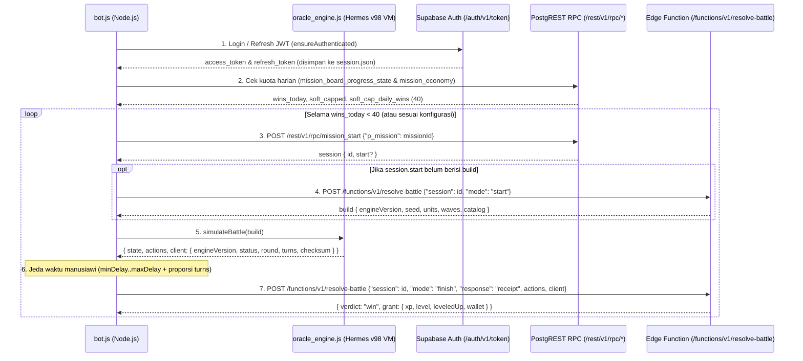

# 04 — Panduan & Arsitektur Bot AFK EXP Headless (Metode A)

Dokumen ini menjelaskan arsitektur teknis, mekanisme kerja, serta panduan penggunaan **Headless AFK EXP Bot (Metode A)** yang telah dibangun di direktori [`bot/`](../bot/).

---

## 1. Gambaran Umum Arsitektur (Metode A)

Pada **Metode A (Pure Background / Headless API Bot)**, bot berjalan sepenuhnya di Node.js tanpa memerlukan emulator Android, layar, maupun antarmuka grafis (0% penggunaan GPU).

Tantangan terbesar pada Metode A adalah validasi deterministik dari server *Ninja Horizon*:
1. Saat pertarungan dimulai (`POST /functions/v1/resolve-battle` dengan `mode: "start"`), server memberikan `build` yang berisi `engineVersion`, `seed` (PRNG `imul32`), daftar `units`, `waves`, dan `catalog` (definisi *skill*, *gear*, dan musuh).
2. Saat pertarungan selesai (`mode: "finish"`), klien wajib mengirimkan:
   - Array `actions`: urutan aksi setiap giliran (`{ type: "skill", skillId: "..." }`, `{ type: "attack" }`, dll.).
   - Objek `client` (`replayDiagnostic`): berisi `{ engineVersion, status, round, turns, activeId, checksum }`.
3. Server kemudian memutar ulang (*replay*) pertarungan dari `seed` awal menggunakan `actions` yang dikirimkan klien dan mencocokkan nilai `checksum` akhir (`fnv1a` 32-bit bertanda).

### Solusi: Eksekusi Langsung Bytecode Hermes v98 Mesin Oracle (`oracle_engine.js`)
Agar perhitungan PRNG, *turn gauge*, *damage*, *status effects*, hingga *checksum* `fnv1a` dijamin **100% identik** dengan aplikasi resmi (dan tahan terhadap perbedaan pembulatan *floating-point* atau *edge-case*), kami mengekstrak seluruh 3.806 fungsi bytecode Hermes v98 yang membentuk modul **Oracle Battle Engine** langsung dari [`index.android.bundle`](../Docs/03_Mesin_Pertarungan_Oracle_dan_Ruffle_SWF.md) ke dalam:
- [`bot/oracle_bytecode.bin`](../bot/oracle_bytecode.bin) & [`bot/oracle_meta.json`](../bot/oracle_meta.json): Paket instruksi bytecode, tabel string, *object/array literal buffers*, dan *switch tables* untuk modul `627`, `628`, `629`, `630`, dan `631`.
- [`bot/oracle_engine.js`](../bot/oracle_engine.js): Mesin Virtual (*Virtual Machine*) Hermes v98 mandiri di Node.js yang memuat ketiga versi mesin Oracle sekaligus:
  - `8b314b03` (Oracle terbaru — `module 628`)
  - `b87fcb76` (Oracle kompatibilitas — `module 629`)
  - `5022613f` (Oracle legacy — `module 630`)

Dengan pendekatan ini, ketika server meminta simulasi menggunakan versi mesin mana pun (`8b314b03`, `b87fcb76`, atau `5022613f`), [`simulateBattle()`](../bot/oracle_engine.js#L510-L574) secara otomatis memilih modul yang tepat, menjalankan `initMatch` -> `runUntilHuman` -> `suggestPlannedAction` / `suggestPlayerAction` -> `applyAction`, dan menghasilkan `checksum` yang terverifikasi 100% cocok dengan fungsi `engine.replay()`.

---

## 2. Alur Siklus Kerja Bot (`bot/bot.js`)



### Fitur Keamanan & Reliabilitas Bawaan di [`bot/bot.js`](../bot/bot.js)
1. **Header Protokol Identik dengan APK Asli**:
   Mengirimkan header persis seperti `interceptedFetch` (`func[22436]`):
   - `apikey: sb_publishable_fmv5Sz29F8kwXJCsa0Q_uQ_F98vjN6J`
   - `x-client-info: supabase-js-react-native/2.97.0 nh-senjutsu/1`
   - `x-battle-engines: 8b314b03,b87fcb76,5022613f`
   - `x-battle-protocol: 1`
2. **Fallback Region Otomatis (`?forceFunctionRegion=us-east-1`)**:
   Meniru `createBattleRegionFetch` (`func[26886]`) di APK: jika Edge Function mengembalikan HTTP `502`/`504`/`503`, bot otomatis mengalihkan rute ke region `us-east-1` selama 60 detik.
3. **Retry Otomatis pada Timeout Penyelesaian Battle**:
   Meniru `finishBattle` (`func[23327]`): jika server mengalami lonjakan beban dan mengembalikan HTTP `504` atau `546` saat `mode: "finish"`, bot otomatis melakukan *retry* tanpa kehilangan sesi pertarungan.
4. **Auto-Refresh Token Sesi (`session.json`)**:
   Token JWT memiliki masa berlaku 1 jam. Bot membaca klaim `exp` pada JWT dan secara otomatis memperbarui token menggunakan `refresh_token` sebelum habis, sehingga dapat berjalan AFK berjam-jam tanpa putus.
5. **Proteksi Kuota Harian (*Soft-Cap* 40 Kemenangan)**:
   Secara bawaan (`"stopOnSoftCap": true`), bot memeriksa `wins_today` dan berhenti otomatis ketika mencapai 40 kemenangan harian (titik di mana hadiah dikurangi menjadi 25%).

---

## 3. Struktur File di Folder `bot/`

| File | Deskripsi |
| :--- | :--- |
| [`bot/bot.js`](../bot/bot.js) | Skrip utama CLI Bot AFK EXP (`NinjaHorizonClient`, manajemen sesi, loop misi, dan CLI). |
| [`bot/oracle_engine.js`](../bot/oracle_engine.js) | Interpreter bytecode Hermes v98 untuk mengeksekusi modul Oracle (`8b314b03`, `b87fcb76`, `5022613f`). |
| [`bot/oracle_bytecode.bin`](../bot/oracle_bytecode.bin) | Paket biner instruksi bytecode dari 3.806 fungsi mesin Oracle yang diekstrak dari APK. |
| [`bot/oracle_meta.json`](../bot/oracle_meta.json) | Metadata fungsi, tabel string, dan *literal buffers* untuk `oracle_engine.js`. |
| [`bot/config.example.json`](../bot/config.example.json) | Contoh file konfigurasi akun dan parameter bot. |
| [`bot/package.json`](../bot/package.json) | Definisi skrip npm (`npm test`, `npm start`, `npm run status`). Tidak memerlukan `npm install` (0 dependensi eksternal). |

---

## 4. Cara Konfigurasi & Penggunaan

### Langkah 1: Verifikasi Mesin Simulasi Secara Offline
Pastikan Node.js (v18+) sudah terpasang, lalu jalankan pengujian simulasi offline:

```powershell
cd "bot"
node bot.js --test-sim
```

Output yang diharapkan:
```text
[INFO]  Versi mesin Oracle yang dimuat: 8b314b03, b87fcb76, 5022613f (terbaru: 8b314b03)
[OK]    Engine [8b314b03] -> Status: WIN | Round: 5 | Turns: 9 | Actions: 5 | Checksum: 174593708 (Replay Verified)
[OK]    Engine [b87fcb76] -> Status: WIN | Round: 5 | Turns: 9 | Actions: 5 | Checksum: 174593708 (Replay Verified)
[OK]    Engine [5022613f] -> Status: WIN | Round: 5 | Turns: 9 | Actions: 5 | Checksum: 174593708 (Replay Verified)
[OK]    Semua 3 versi mesin Oracle berjalan 100% deterministik dan siap digunakan!
```

### Langkah 2: Autentikasi Akun (SSO Google atau Email/Password)

#### Opsi A (Direkomendasikan): Login Interaktif via SSO Google (`--login-google`)
Dari hasil dekompilasi fungsi `restoreSignIn` (`func[25111]`), `runOAuth` (`func[25108]`), dan `parseAuthUrl` (`func[10494]`) di dalam APK, *Ninja Horizon* menggunakan alur *Implicit OAuth* Supabase (`/auth/v1/authorize?provider=google&prompt=select_account`). Ketika login Google di browser selesai, Supabase mengalihkan (*redirect*) browser ke halaman statis `https://ninjahorizon.com/#access_token=...&refresh_token=...`.

Karena halaman `https://ninjahorizon.com` adalah halaman *landing* statis yang tidak menghapus *fragment* `#access_token=...` dari *Address Bar* browser, Anda **tidak perlu memasukkan email maupun password** ke dalam `config.json`:

1. Jalankan perintah berikut di terminal:
   ```powershell
   node bot.js --login-google
   ```
   *(Atau `npm run login`)*
2. Browser default PC Anda akan otomatis terbuka ke halaman pilih akun Google resmi *Ninja Horizon*.
3. Pilih akun Google Anda. Setelah dialihkan ke `https://ninjahorizon.com/#access_token=...`, **salin (Copy) seluruh URL dari Address Bar browser** Anda.
4. **Tempel (Paste)** URL tersebut ke terminal `bot.js`.
5. [`runGoogleSsoLogin()`](../bot/bot.js#L563-L637) akan mengekstrak `access_token` dan `refresh_token` menggunakan logika [`parseAuthCallbackUrl()`](../bot/bot.js#L525-L551), menyimpannya ke `bot/session.json`, dan otomatis memperbarui token sesi di masa mendatang tanpa perlu login ulang.

#### Opsi B: Konfigurasi Manual via File `bot/config.json`
Salin [`bot/config.example.json`](../bot/config.example.json) menjadi `bot/config.json`:

```powershell
Copy-Item config.example.json config.json
```

Jika Anda sudah login menggunakan `--login-google`, biarkan kolom `email`, `password`, `refreshToken`, dan `accessToken` di `config.json` tetap kosong `""` (bot otomatis membaca `bot/session.json`). Jika menggunakan akun email biasa, Anda dapat mengisi `"email"` dan `"password"`.

Contoh isi `bot/config.json`:
```json
{
  "email": "akun_anda@email.com",
  "password": "password_anda",
  "refreshToken": "",
  "accessToken": "",
  "missionId": "msn_1",
  "autoPlan": true,
  "minDelaySeconds": 8,
  "maxDelaySeconds": 15,
  "betweenMissionMinSeconds": 4,
  "betweenMissionMaxSeconds": 9,
  "stopOnSoftCap": true,
  "maxRuns": 0
}
```

### Langkah 3: Cek Status Akun & Daftar Misi
Sebelum menjalankan loop AFK, Anda dapat memeriksa koneksi autentikasi, jumlah kemenangan hari ini, serta daftar ID misi yang tersedia:

```powershell
# Cek status kuota harian & ekonomi misi
node bot.js --status

# Tampilkan daftar misi & progress papan misi dari server
node bot.js --list-missions
```

### Langkah 4: Jalankan Bot AFK EXP
Untuk menjalankan bot sesuai `config.json`:

```powershell
node bot.js
```

Atau dengan argumen tambahan langsung dari terminal:
```powershell
# Jalankan misi tertentu sebanyak 10 kali
node bot.js --mission msn_2 --runs 10
```

---

## 5. Tips Keamanan Penggunaan (Anti-Deteksi)

1. **Jangan Mengubah `minDelaySeconds` Menjadi `0`**:
   Meskipun `oracle_engine.js` sanggup menyelesaikan simulasi pertarungan hanya dalam ~0,2 detik di CPU, manusia membutuhkan waktu beberapa detik untuk menyelesaikan pertarungan. Pertahankan `minDelaySeconds` minimal di angka `8`–`15` detik.
2. **Jangan Membuka Pertarungan di Aplikasi HP Secara Bersamaan**:
   Saat bot sedang berjalan, server hanya mengizinkan satu sesi misi aktif per karakter (`mission_start`). Membuka pertarungan dari HP secara bersamaan dapat memicu konflik sesi.
3. **Manfaatkan `stopOnSoftCap: true`**:
   Setelah 40 kemenangan per hari, hadiah EXP dan Gold dipangkas oleh server menjadi 25% (`soft_cap_Consolidation_mult: 0.25`). Berhenti otomatis pada batas 40 kemenangan menjaga pola aktivitas akun tetap wajar seperti pemain aktif harian.


---

## 6. Pembaruan: Engine OTA, Ekonomi Misi Sebenarnya & Pemilihan Misi Otomatis

Pengujian dengan akun nyata (login SSO Google) mengungkap tiga koreksi penting terhadap asumsi awal:

### 6.1 Engine bawaan APK sudah "retired" oleh server
`game_config.battle_engine_policy` (revisi 30) di server:

| Field | Nilai |
| :--- | :--- |
| `active` | `a2c6a492` |
| `accepted` | `47931e6b`, `a2c6a492` |
| `retired` | termasuk `8b314b03`, `b87fcb76`, `5022613f` (ketiga engine di APK) |

Aplikasi asli memperbarui dirinya lewat **HotUpdater OTA** (`https://updates.ninjahorizon.com/api/check-update/fingerprint/android/<FINGERPRINT_HASH>/production/<bundleId>/<minBundleId>`, format URL dari `checkUpdate` `func[28193]`). Bundle OTA terbaru (`01a1a32e-d172-747c-8354-4621131e982a`, *"Clan Quick verification window"*) diunduh, lalu modul engine diekstrak ulang:

| Versi Engine | Modul OTA | Keterangan |
| :--- | :--- | :--- |
| `a2c6a492` | `628` | Engine aktif server (default bot) |
| `47931e6b` | `630` | Engine yang masih diterima |

`oracle_bytecode.bin` / `oracle_meta.json` sekarang berisi 2.556 fungsi dari bundle OTA. Versi lama disimpan di `bot/legacy_apk_engines/`. Bot memeriksa `battle_engine_policy` setiap kali start dan **berhenti dengan pesan jelas** jika engine lokal sudah tidak diterima (artinya perlu ekstrak ulang dari OTA terbaru).

### 6.2 `mission_economy` bukan RPC, dan tidak ada `wins_today`
- RPC `mission_economy` tidak ada. Konfigurasi dibaca dari tabel `game_config` (`key = 'mission_economy'`), sesuai `fetchMissionEconomy` (`func[23579]`).
- `mission_board_progress_state` hanya mengembalikan `{ clears: [...] }`.
- Aturan sebenarnya: **daily double** (3 kemenangan pertama per hari x2) dan **gold soft-cap** (setelah 15 kemenangan per hari, gold tinggal 25%). Tidak ditemukan batas XP harian.
- Karena itu bot menghitung kemenangan hariannya sendiri di `bot/daily.json` (hari UTC). Batas default = `mission_gold_soft.full_wins` (15), bisa diubah dengan `maxWinsPerDay`.

### 6.3 Pemilihan misi otomatis
Dengan `"missionId": "auto"` (default baru), bot membaca level dari `player_avatar` dan memilih misi non-exam dengan XP tertinggi dari `mission_defs` yang levelnya ≤ level karakter. Lihat kandidatnya dengan `node bot.js --list-missions`.
